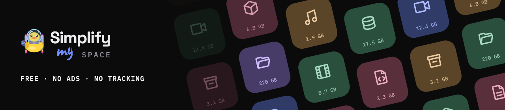
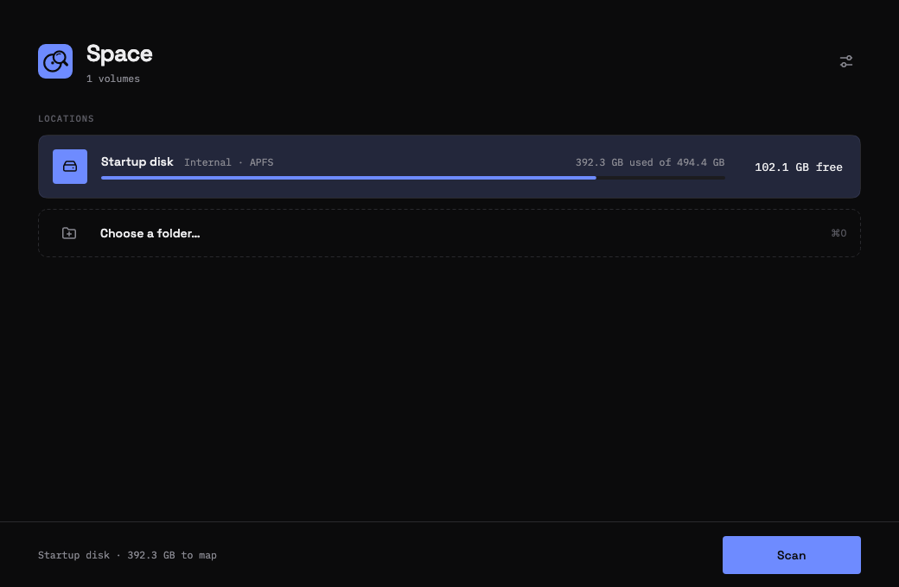
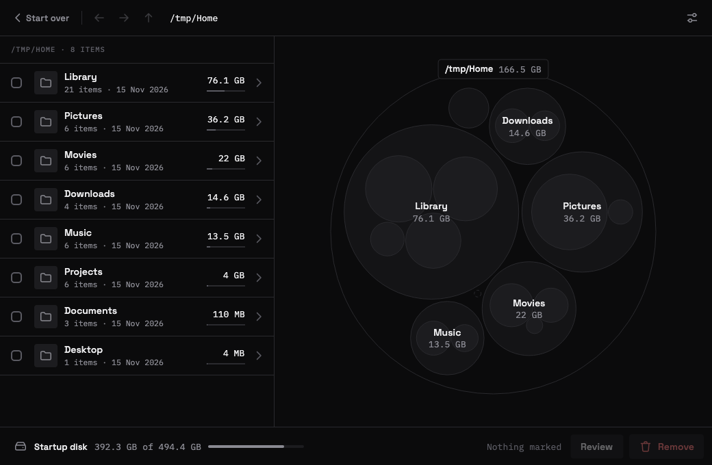
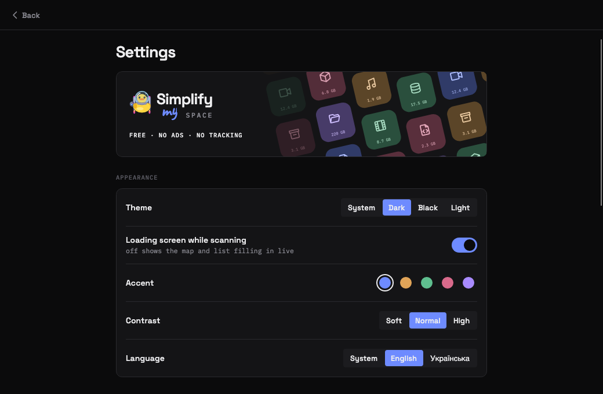

<p align="center">
  
</p>
<p align="center">
  <b>See what fills your disk, and clear it in a few clicks.</b><br>
  Free. No ads, no account, no analytics. Everything is scanned on your computer.
</p>

<p align="center">
  <a href="https://github.com/simplifymy-app/space/releases">Download</a> ·
  <a href="https://simplifymy.app/">Website</a> ·
  <a href="https://github.com/simplifymy-app/space/releases">Changelog</a>
</p>

<p align="center">
  
  
  
</p>

A disk-space explorer for macOS and Windows. Pick a drive or a folder, and it shows what takes the space as a map of bubbles beside a list sorted by size: the bigger the bubble, the more it holds. Click through folders until you find what you no longer need, mark it, review it, and send it to the Trash. Nothing is uploaded and nothing is deleted behind your back. Around the map sits the same quiet interface as the other Simplify apps: a list, a map and a settings page that only holds what you use.

## ✦ What it does

| | |
| --- | --- |
| **Scan** | Any drive or folder, many folders at once. On macOS it reads whole folders per system call with `getattrlistbulk`, the same call the paid disk tools use. A loading screen while it counts, or watch the map fill in live |
| **Map** | Every folder as a bubble sized by the space it uses, with a preview of what is inside the large ones. Hover for the full path, size and share of the parent; double-click to go in |
| **List** | Sorted by size, with item counts, dates, a share bar and a plain description for system folders like Library, System or AppData |
| **Navigate** | Breadcrumb path, back, forward and up, by mouse or keyboard. Reveal in Finder or Explorer, open, copy path |
| **Mark** | Check items anywhere in the tree; a folder with marked items inside shows how much. The bottom bar shows what you will get back |
| **Remove** | Review everything marked, then move it to the Trash or Recycle Bin, so it can come back. Deleting permanently is a separate, explicit choice |
| **Safe by default** | System folders, your home folder, volume roots and the app itself cannot be marked. Symlinks are not followed and hard links count once, so nothing is counted twice |
| **Sizes** | Size on disk or logical size, in GB or GiB, switched live |
| **Make it yours** | System, dark, black or light, five accents, text contrast. The app icon follows your accent |
| **Language** | English and Ukrainian, picked in the app regardless of the system |
| **Updates** | Checks for a new version in the background and installs it on restart. Can be turned off |

There is no analytics, no crash reporting and no account. The only network request the app makes is the update check, and that can be switched off in Settings.

## 📦 Install

Get the installer for your system from the [Releases](https://github.com/simplifymy-app/space/releases) page:

| | |
| --- | --- |
| **macOS** 14 or newer | `SimplifyMySpace-osx-arm64-Setup.pkg` for Apple silicon, `osx-x64` for Intel |
| **Windows** 10 or newer | `SimplifyMySpace-win-x64-Setup.exe`, or `win-arm64` |

Installed copies update themselves. On macOS, folders the system protects, like Mail and Safari data, are only included after you allow Full Disk Access under System Settings › Privacy & Security; without it they are skipped and counted.

## 🔨 Build

You need the .NET 11 SDK (`make sdk` installs it into `~/.dotnet` if the system has none). Use the Makefile, not raw dotnet.

```
make run          # build and run from source
make test         # the Core tests
make bundle       # signed, trimmed "Simplify my Space.app" into build/
make pack         # Velopack installer, portable zip and update feed for one runtime
make pack-macos   # Apple silicon and Intel
make pack-windows # x64 and arm64; the MSI and signing need Windows
make art          # re-render the icons, banner, installer art and these screenshots
make bump-patch   # also bump-minor, bump-major, set-version VERSION=x.y.z
make tag          # tag HEAD as v<version> and push it, which publishes a release
```

`make help` lists the rest. Everything a build produces goes to `build/`, which is safe to delete.

To release: `make bump-patch`, commit, then `make tag`. The tag starts the release workflow, which checks it matches the version, tests, packs every installer, and publishes the GitHub release with notes written from the commits since the last tag. Installed copies pick it up as an update.

Releases are signed with your own certificate when `SIGN_IDENTITY` is set; without it the app is signed with an Apple Development identity or ad-hoc, so a fresh clone still builds a runnable app. `make certificate` creates a stable development identity, so macOS keeps its permissions between builds.

### Tests

The tests in `tests/Core.Tests` build their own folder trees in a temporary directory, so they never depend on, or touch, what is on your disk. They cover sizes, hard links, symlink loops, unreadable folders, protected paths, the bubble packing, marking and navigation.

## 🧭 Layout

```
src/Core              scanner, file tree, marking, removal, bubble packing, theme tokens, strings
src/Platform.Mac      getattrlistbulk listing, Trash, Reveal in Finder
src/Platform.Windows  directory listing with cluster sizes, Recycle Bin, Show in Explorer
src/App               Avalonia: start screen, list, map, review, settings, scan screen
tests/Core.Tests      Core tests on temporary folder trees
assets/               app icons, brand images, installer art, screenshots
scripts/              bundle and pack for macOS and Windows, version bump, art generator
```

C# on .NET 11 with Avalonia, published trimmed into a single file. The interface follows the Simplify design system shared with the other apps. Ships in English and Ukrainian; every language always has the same keys.

## 📄 License

© 2026 Simplify my app. The source code is licensed under the [Mozilla Public License 2.0](LICENSE): you may use, change and ship it, also in closed or commercial apps, but changes to these files must stay under the MPL and be shared. It is provided as is, without warranty of any kind.

The libraries the app is built on — Avalonia, SkiaSharp, HarfBuzzSharp and Velopack — are under the MIT License. The bundled fonts Space Grotesk, Manrope, IBM Plex Mono and Caveat are under the SIL Open Font License 1.1; their copyright notices and the full licence text are in [`licenses/`](licenses).
